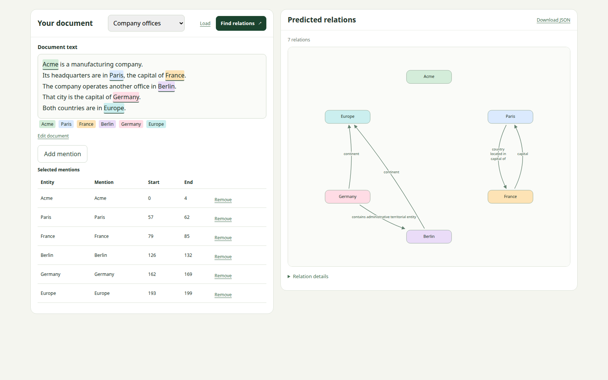

# ATLOP

Extract relations between entities in a document.

*Each entity pair learns a relation threshold and pools the context both entities attend to.*

## Summary

**Input:** document text and selected mention spans; each selection becomes a separate entity.

**Output:** a relation graph and downloadable JSON with mention spans. Offsets start at zero; end is exclusive.




## Reference

[main.ipynb](main.ipynb) walks through the mechanism. The web demo loads `checkpoints/local-bert.pt` from your training run.

Dataset examples: [annotated training](data/docred/train_annotated.example.json), [distant training](data/docred/train_distant.example.json), [dev](data/docred/dev.example.json), and [test](data/docred/test.example.json). Each contains one original DocRED record; test labels are withheld. Full datasets stay ignored.

## Verification

Completed 30 epochs with seed 66; the best checkpoint is epoch 29.

| Dev result | F1 | Ign F1 |
|---|---:|---:|
| Local | 60.80 | 58.97 |
| Paper, five-seed mean | 61.09 | 59.22 |

Full precision and comparison: [results.json](results.json). Test labels are withheld; no test score is reported.

## Run

From the repository root:

```bash
cp ie_atlop/pyproject.toml pyproject.toml
cp ie_atlop/uv.lock uv.lock
uv sync --locked --python 3.8 --no-install-package apex
uv sync --locked
make -C ie_atlop train
make up
```

After setup, `make up` starts the interface from the repository root or `ie_atlop/`. Stop it with Ctrl-C.

Open <http://127.0.0.1:7861>; forward port **7861** in remote VS Code.

Fresh checkout: run `scripts/download_data.sh` and `scripts/download_model.sh` from `ie_atlop/` first.

Retrain with `make -C ie_atlop train`. Training starts from pretrained BERT and replaces the local checkpoint.

## Links

- [ATLOP source](https://github.com/wzhouad/ATLOP/tree/1db77ab8bc4fe5f7f8c23067ea17055d58b310a3)
- [Authors’ checkpoint](https://github.com/wzhouad/ATLOP/releases/tag/1.0)
- [DocRED data](https://github.com/thunlp/DocRED/tree/master/data)
- [Paper](https://ojs.aaai.org/index.php/AAAI/article/view/17717)
