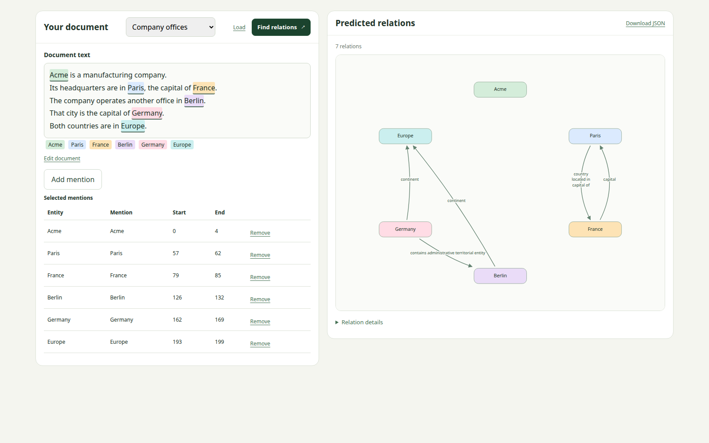

# ATLOP — modified version

Saved as `ie_atop_modify`: independent-span training and web inference.

Extract relations between entities in a document.

*Each entity pair learns a relation threshold and pools the context both entities attend to.*

## Summary

**Input:** document text and selected mention spans; each selection becomes a separate entity.

**Output:** a relation graph and downloadable JSON with mention spans. Offsets start at zero; end is exclusive.




## Reference

[main.ipynb](main.ipynb) explains the mechanism. Examples: [train](data/docred/train_annotated.example.json), [distant train](data/docred/train_distant.example.json), [dev](data/docred/dev.example.json), [test](data/docred/test.example.json).

Converted arrays: `data/docred/`. Original downloads: `data/raw/docred/`. Full datasets are ignored by Git.

- `spans`: independent mentions with character offsets and entity types; repeated names are not grouped.
- `relations`: labeled connections between `head` and `tail` span IDs. Each entry contains a relation `label`; one pair can have multiple labels.
- `reviewed_pairs`: pairs with complete annotation coverage inherited from DocRED. A listed pair with no entry in `relations` becomes a no-relation target during preprocessing. Unlisted, unlabeled pairs stay unknown.

Conversion retains relations only between single-mention source entities, so some train/dev records have empty `relations`.

**Test labels are withheld by DocRED.** Empty test `relations` means unknown. Evaluate on dev; export predictions for test.

| Split | Documents | `relations` entries | No-relation pairs generated from `reviewed_pairs` |
|---|---:|---:|---:|
| Annotated training | 3,053 | 15,538 | 800,567 |
| Distant training | 101,873 | 770,800 | 26,136,421 |
| Dev | 998 | 4,988 | 264,196 |
| Test | 1,000 | Unavailable | Not generated |

Distant training is optional. Loss and evaluation ignore unknown labels; span F1 is not directly comparable to grouped DocRED F1.

## Verification

Grouped baseline: 30 epochs, seed 66, best epoch 29.

Span training completed: 30 epochs, seed 66, best epoch 26. Dev F1 **57.17**, precision **64.90**, recall **51.08** on known span labels. Details: [results-spans.json](results-spans.json).

| Dev result | F1 | Ign F1 |
|---|---:|---:|
| Local | 60.80 | 58.97 |
| Paper, five-seed mean | 61.09 | 59.22 |

Baseline details: [results.json](results.json).

## Run

From the repository root:

```bash
cp ie_atop_modify/pyproject.toml pyproject.toml
cp ie_atop_modify/uv.lock uv.lock
uv sync --locked --python 3.8 --no-install-package apex
uv sync --locked
bash ie_atop_modify/scripts/download_data.sh
bash ie_atop_modify/scripts/download_model.sh
make -C ie_atop_modify prepare-data
make -C ie_atop_modify train
bash ie_atop_modify/scripts/web.sh --checkpoint checkpoints/spans-bert.pt
```

Open <http://127.0.0.1:7861>; forward port **7861** in remote VS Code. `make up` loads `checkpoints/spans-bert.pt`. The interface sends independent spans and downloads `document_id`, `text`, `spans`, and predicted `relations`; offsets are zero-based Unicode characters with exclusive ends.

Training saves `checkpoints/spans-bert.pt`, `results-spans.json`, and `artifacts/span-predictions.json`. Monitor with `tail -f ie_atop_modify/artifacts/train-spans.log`.

`prepare-data` converts all four splits, writes summaries, and refuses existing output paths.

## Links

- [ATLOP source](https://github.com/wzhouad/ATLOP/tree/1db77ab8bc4fe5f7f8c23067ea17055d58b310a3)
- [Authors’ checkpoint](https://github.com/wzhouad/ATLOP/releases/tag/1.0)
- [DocRED data](https://github.com/thunlp/DocRED/tree/master/data)
- [Paper](https://ojs.aaai.org/index.php/AAAI/article/view/17717)
